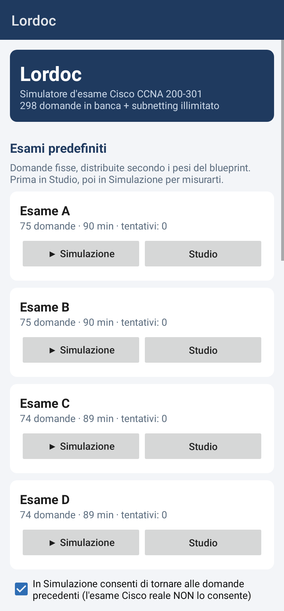
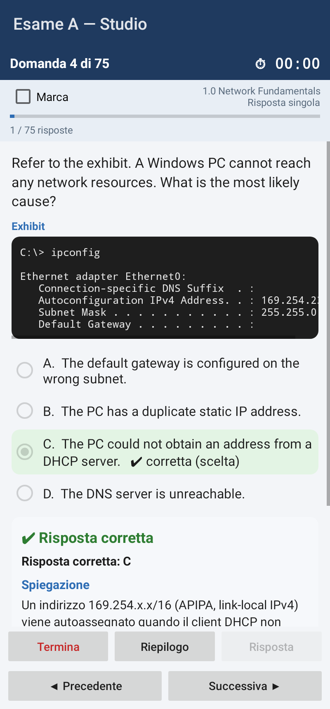
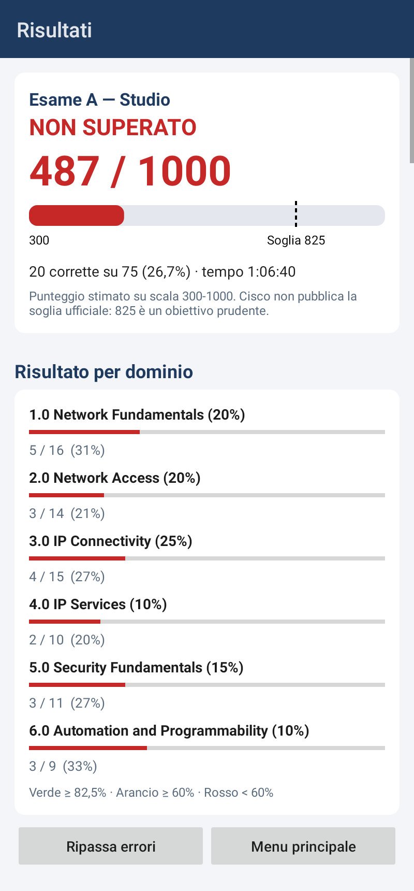

# Lordoc Android

Versione **Android** di Lordoc, il simulatore d'esame per la preparazione alla certificazione
**Cisco CCNA 200-301**. Scritta in **Java** usando solo le API standard di Android, senza librerie
esterne.

> Realizzato in collaborazione con **Anthropic Claude**.

<p>



</p>

## Funzionalità

| Funzione | Descrizione |
|---|---|
| **Modalità Simulazione** | Tempo limite (~1,2 min/domanda, come all'esame reale). Risposte e spiegazioni visibili solo alla consegna. Il tempo continua a scorrere anche se l'app va in secondo piano. Puoi vietare il ritorno alle domande precedenti, come all'esame Cisco. |
| **Modalità Studio** | Senza limite di tempo. Il pulsante "Risposta" mostra correzione, spiegazione in italiano e riferimento all'exam topic. |
| **Esami predefiniti** | 4 esami (A-D) da circa 75 domande, senza domande in comune, distribuite secondo i pesi ufficiali dei domini. |
| **Opzioni mescolate** | A ogni esame l'ordine delle risposte cambia, così si memorizza il concetto e non la lettera. |
| **Esame personalizzato** | Domini, numero di domande, filtro (tutte / mai viste / sbagliate / marcate), tempo e modalità. |
| **Generatore di subnetting** | Esercizi IPv4 sempre nuovi con soluzione passo-passo (metodo del *magic number*). |
| **Tipi di domanda** | Scelta singola, scelta multipla ("Choose two"), abbinamento (drag and drop), risposta aperta; exhibit con output CLI, JSON e così via. |
| **Marca e riepilogo** | Marca le domande e apri il riepilogo con quelle incomplete o marcate. |
| **Report finale** | Punteggio su scala 300-1000 con soglia 825, esito per dominio, revisione di ogni domanda e ripasso immediato degli errori. |
| **Storico e progressi** | Esami svolti, grafico dei punteggi e accuratezza per dominio, salvati sul telefono. |
| **Cheat sheet** | 12 schede di ripasso (subnetting, IPv6, OSPF, STP, wireless, porte, sicurezza, automazione, comandi IOS…). |
| **Calcolatore subnet** | Rete, broadcast, range host, wildcard, magic number e rappresentazione binaria. |
| **Importa domande** | Aggiungi file `.txt` di domande scritti nel formato di Lordoc, direttamente dal telefono. |

## Contenuti

298 domande originali sul blueprint **CCNA 200-301 v1.1**, più le domande di subnetting generate senza
limiti. Testo e opzioni sono in inglese, come all'esame reale; le spiegazioni sono in italiano.

| Dominio | Peso | Domande |
|---|---|---|
| 1.0 Network Fundamentals | 20% | 63 |
| 2.0 Network Access | 20% | 55 |
| 3.0 IP Connectivity | 25% | 61 |
| 4.0 IP Services | 10% | 39 |
| 5.0 Security Fundamentals | 15% | 45 |
| 6.0 Automation and Programmability | 10% | 35 |

## Installare l'app sul telefono

**Senza compilare nulla (consigliato):**

1. Su GitHub apri la scheda **Actions**, scegli l'ultima esecuzione con la spunta verde e scarica
   l'artefatto **lordoc-apk** (è uno zip che contiene `app-debug.apk`).
2. Copia `app-debug.apk` sul telefono e aprilo. Android chiederà di consentire l'installazione da
   "origini sconosciute" per l'app con cui lo apri (es. File o Chrome): consentilo per questa volta.

Serve **Android 8.0** o successivo.

## Compilare il progetto

### Con Android Studio

1. Installa [Android Studio](https://developer.android.com/studio).
2. *File → Open* e scegli la cartella del progetto. Android Studio scarica da solo Gradle e l'SDK necessari.
3. Collega il telefono con il cavo USB (con il *debug USB* attivo nelle opzioni sviluppatore) oppure
   crea un emulatore, poi premi **Run ▶**.

### Da riga di comando

Serve un JDK 17+ e l'Android SDK (la variabile `ANDROID_HOME` o il file `local.properties` devono
indicare dove si trova).

```bash
./gradlew assembleDebug        # Windows: gradlew.bat assembleDebug
# APK: app/build/outputs/apk/debug/app-debug.apk

./gradlew testDebugUnitTest    # test automatici
./gradlew lintDebug            # controlli di Android (compatibilità, errori comuni)
```

## Struttura del progetto

```
LORDOC-ANDROID/
├── settings.gradle, build.gradle, gradle.properties   configurazione di Gradle
├── gradlew, gradlew.bat, gradle/wrapper/              Gradle "incorporato" (non va installato)
├── .github/workflows/build.yml                        CI: test, lint e APK scaricabile
└── app/
    ├── build.gradle                                   versione dell'app, SDK minimo e di destinazione
    └── src/
        ├── main/
        │   ├── AndroidManifest.xml                    schermate dell'app
        │   ├── assets/questions/                      banca domande (.txt) + index.txt
        │   ├── assets/reference/                      cheat sheet (.html) + index.txt
        │   ├── res/                                   tema, colori, icona
        │   └── java/com/lordoc/
        │       ├── model/  data/  engine/  util/      logica (condivisa con Lordoc desktop)
        │       └── android/                           schermate e componenti Android
        └── test/java/com/lordoc/android/SmokeTest.java  test automatici
```

### Le schermate (`com.lordoc.android`)

| Classe | Schermata |
|---|---|
| `MainActivity` | menu principale: esami predefiniti, altre modalità, strumenti, copertura per dominio, importazione domande |
| `CustomExamActivity` | configurazione dell'esame personalizzato |
| `ExamActivity` | svolgimento dell'esame: cronometro, marcatura, riepilogo, consegna |
| `ResultsActivity` / `ReviewActivity` | report finale e revisione domanda per domanda |
| `HistoryActivity` | storico, grafico dei punteggi e accuratezza per dominio |
| `ReferenceActivity` / `ReferencePageActivity` | elenco e visualizzazione delle schede del cheat sheet |
| `SubnetCalculatorActivity` | calcolatore IPv4 |
| `QuestionRenderer` | disegna una domanda (usata da esame e revisione) |
| `ScoreBarView`, `ScoreChartView` | barra del punteggio e grafico disegnati a mano |
| `LordocApp` | carica domande e dati all'avvio, conserva l'esame in corso |
| `Ui` | colori e funzioni comuni per creare i componenti |

### Rapporto con Lordoc desktop

I pacchetti `model`, `data`, `engine` e `util` sono la stessa logica della versione desktop (Java Swing),
con tre adattamenti per Android:

- domande e cheat sheet si leggono dagli **assets** dell'app (interfaccia `ResourceOpener`) invece che
  dal JAR;
- storico e statistiche si salvano nella **cartella privata dell'app** invece che in `~/.lordoc`;
- alcune funzioni di Java 10/11 (`List.copyOf`, `String.isBlank`, `Files.writeString`…) sono sostituite
  da equivalenti disponibili su tutte le versioni di Android supportate (vedi `util/Text.java`).

Se correggi una domanda o la logica in una delle due versioni, riporta la modifica anche nell'altra.

## Aggiungere domande

- **Dal telefono:** menu principale → *Importa domande (.txt)* e scegli uno o più file. Le domande
  vengono copiate nell'app e caricate subito; eventuali errori di formato vengono mostrati.
- **Nel progetto (per tutti):** aggiungi i blocchi in `app/src/main/assets/questions/` (se crei un
  nuovo file, elencalo in `index.txt`) e ricompila. Il test `laBancaDomandeSiCaricaSenzaErrori` fallisce
  se una domanda ha errori di formato.

Il formato è lo stesso della versione desktop:

```text
[Q]
id: NF-100
domain: 1
type: SINGLE
text:
Testo della domanda.
options:
A) Prima opzione
B) Seconda opzione
answer: B
explanation:
Spiegazione in italiano (non citare le lettere: le opzioni vengono mescolate).
reference: Exam topic 1.6
[/Q]
```

Tipi: `SINGLE`, `MULTI` (`answer: A, C`), `FILL` (`answer: 30 | trenta`), `DRAG`
(`items:` con righe `elemento => categoria`). Campi facoltativi: `exhibit:`, `targets:`, `shuffle: no`.

## Note

- Il blueprint **v2.0** sostituisce il v1.1 dal febbraio 2027: le domande seguono il v1.1.
- Il punteggio su scala 300-1000 è una stima: Cisco non pubblica la soglia ufficiale.
- Se Android chiude l'app mentre è in secondo piano, l'esame in corso va perso (storico e statistiche
  restano salvati).

## Note legali

Progetto indipendente a scopo didattico, non affiliato né approvato da Cisco Systems, Inc.
CCNA e Cisco sono marchi registrati di Cisco Systems, Inc. Tutte le domande sono originali.

Realizzato in collaborazione con Anthropic Claude.
